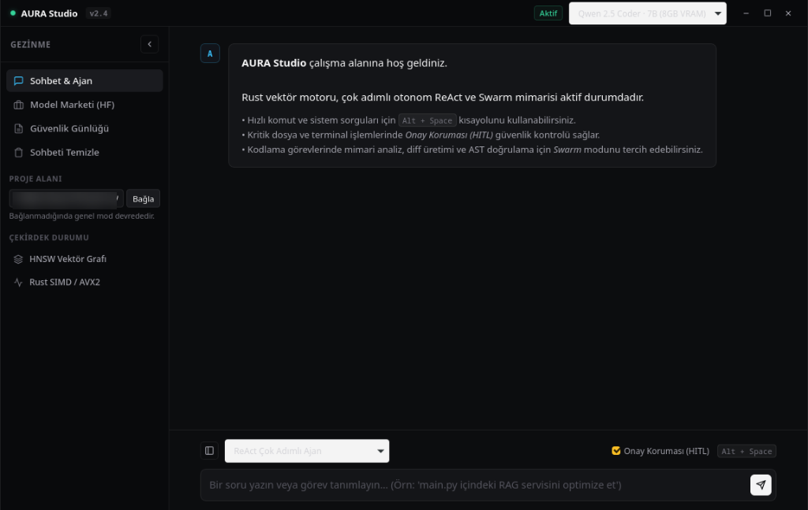

<div align="center">

# AURA-CORE & AURA Studio

**Yerel Otonom Ajan Mimarisi, Süreç İçi Rust Vektör Motoru ve Masaüstü Geliştirme Ortamı**  
*Privacy-Preserving Local Agentic AI Engine, In-Process Rust Vector Database & Desktop Studio*

[](https://www.rust-lang.org/)
[](https://www.python.org/)
[](https://fastapi.tiangolo.com/)
[](https://tauri.app/)
[](./LICENSE)

[Türkçe Dokümantasyon](#türkçe-dokümantasyon) • [English Documentation](#english-documentation)

<br/>


*AURA Studio: Gerçek zamanlı düşünce süreci takibi, otonom ReAct ve Swarm modları, süreç içi Rust vektör motoru.*

</div>

---

<a name="türkçe-dokümantasyon"></a>
## 🇹🇷 Türkçe Dokümantasyon

### 1. Genel Bakış ve Temel Yaklaşım

**AURA**, hassas kaynak kodları, teknik dokümantasyonlar ve yerel çalışma alanları üzerinde tam veri egemenliğiyle çalışmak üzere tasarlanmış yerel bir yapay zeka ve otonom ajan ekosistemidir.

Harici bulut API'lerine bağımlılığı ve veri sızıntısı risklerini ortadan kaldırmak amacıyla, çıkarım (inference), anlamsal indeksleme (semantic indexing) ve kod düzenleme döngülerinin tamamı kullanıcının kendi donanımı üzerinde yürütülür.

Sistem iki ana bileşenden meydana gelir:
1. **AURA-CORE:** FastAPI, PyO3 tabanlı süreç içi Rust vektör motoru (`vector_engine`), otonom ReAct ajan döngüsü ve Swarm mimarisinden oluşan modüler arka uç.
2. **AURA Studio:** Tauri 2.0 tabanlı, modern arayüz standartlarına sahip, gerçek zamanlı token ve düşünce akışını gösteren masaüstü kullanıcı arayüzü.

---

### 2. Mimari ve Bileşenler

```
┌────────────────────────────────────────────────────────────────────────┐
│                        AURA Studio (Tauri 2.0)                         │
│  - Gerçek Zamanlı SSE Token Akışı & Düşünce Süreci (Stopwatch)         │
│  - Çalışma Alanı Bağlama, Model Seçimi & HITL Onay Arayüzü            │
│  - Spotlight Hızlı İstek Penceresi (Alt + Space)                      │
└───────────────────────────────────┬────────────────────────────────────┘
                                    │ Loopback HTTP/2 & SSE (127.0.0.1:8000)
┌───────────────────────────────────▼────────────────────────────────────┐
│                       AURA-CORE (FastAPI Motoru)                       │
│  ┌───────────────────────┐ ┌───────────────────┐ ┌──────────────────┐ │
│  │ Intent / Fast Router  │ │ ReAct Ajan Döngüsü│ │ Swarm Orkestrasyon│ │
│  └───────────┬───────────┘ └─────────┬─────────┘ └────────┬─────────┘ │
│              │                       │                    │           │
│  ┌───────────▼───────────────────────▼────────────────────▼─────────┐ │
│  │ Otonomi & Kod Güvenliği Katmanı                                    │ │
│  │ - Semantik Araç Budama (Cosine Vector Pruning)                     │ │
│  │ - Halüsinasyon ve Dosya Varlık Kalkanı (Disk Guard)                │ │
│  │ - Toleranslı Kod Yamalama (Fuzzy Diff Matching - Levenshtein)      │ │
│  │ - Uçuş Kayıtçısı (Flight Recorder - .auratrace.json)               │ │
│  └───────────────────────────────────┬───────────────────────────────┘ │
│                                      │                                 │
│  ┌───────────────────────────────────▼───────────────────────────────┐ │
│  │ Hibrit Bellek ve Veri Katmanı (RAG 2.0)                           │ │
│  │ - Süreç İçi Rust HNSW Yoğun İndeks (PyO3 C-FFI)                   │ │
│  │ - Okapi BM25 Seyrek İndeks & Reciprocal Rank Fusion (RRF)         │ │
│  │ - AST Çağrı Grafı (Call-Graph) & Proje Kuralları (.cursorrules)   │ │
│  │ - Zamansal Bellek Sönümlemesi (Temporal Decay)                    │ │
│  └───────────────────────────────────┬───────────────────────────────┘ │
│                                      │                                 │
│  ┌───────────────────────────────────▼───────────────────────────────┐ │
│  │ Donanım, Çıkarım ve Entegrasyon                                   │ │
│  │ - GGUF Motoru (llama-cpp-python) & KV Prefix Cache (LlamaRAMCache) │ │
│  │ - Bağlam Sıkıştırıcı (Context Compactor)                          │ │
│  │ - Donanım Soyutlama (HAL - CPU Thread Affinity Bağlama)           │ │
│  │ - Model Context Protocol (MCP) & OpenAI Uyumlu Uç Noktalar        │ │
│  └───────────────────────────────────────────────────────────────────┘ │
└────────────────────────────────────────────────────────────────────────┘
```

---

### 3. Çekirdek Yetenekler

#### Otonom Ajan Mimarisi & Kod Zekası
- **Semantik Araç Budama (Semantic Tool Pruning):** İstek bağlamına göre tüm araç tanımlarını isteme (prompt) yığmak yerine, vektör benzerliğiyle en alakalı araçları dinamik olarak seçer ve bağlam israfını önler.
- **Halüsinasyon ve Varlık Doğrulama (Disk Guard):** Ajanın dosya okuma veya düzenleme eylemlerinden önce hedef dosyaların çalışma alanında fiilen var olup olmadığını denetler, hayali yol üretimlerini engeller.
- **Toleranslı Kod Yamalama (Fuzzy Diff Matching):** `apply_diff` aracı, girintileme, satır sonu veya boşluk farklılıklarında Levenshtein tabanlı kayan pencere algoritmasıyla eşleşme sağlayarak yamaların bozulmadan uygulanmasını hedefler.
- **Düşünce Adayı Değerlendirme (Tree-of-Thoughts Yaklaşımı):** Kritik işlemlerde alternatif yürütme adımlarını değerlendirerek en tutarlı aksiyonu seçer.
- **Uçuş Kayıtçısı (Flight Recorder):** Ajanın gerçekleştirdiği düşünce, eylem ve gözlem adımlarını `.aura/traces/` altına `.auratrace.json` formatında kaydederek geriye dönük hata analizi imkanı sunar.

#### Çoklu-Ajan Sürüsü (Swarm) & Derleyici Koruması
- **Rol Odaklı İş Bölümü:** Mimar (iş kırılımı), Kodlayıcı (cerrahi diff üretimi) ve Denetçi (derleme ve test kontrolü) rollerinden oluşan iş akışı.
- **Derleyici Destekli Onarım:** Yapılan kod değişiklikleri sonrasında derleyici veya sözdizim denetimi çalıştırılır; hata durumunda otomatik geri alma ve düzeltme döngüsü işletilir.

#### RAG 2.0: Hibrit Arama & Proje Hafızası
- **Süreç İçi Rust HNSW:** PyO3 bağlarıyla doğrudan Python bellek alanında çalışan, harici ağ gecikmesi veya IPC yükü oluşturmayan yoğun vektör grafı.
- **Reciprocal Rank Fusion (RRF):** Anlamsal benzerlik (vektör) ile kesin anahtar kelime eşleşmesini (Okapi BM25) matematiksel sıralama füzyonuyla birleştirir.
- **AST Tabanlı Çağrı Grafı:** Kaynak kodlardaki fonksiyon çağrı ilişkilerini (Caller -> Callee) çıkararak arama sonuçlarına yapısal bağlam katar.
- **Proje Kuralları Entegrasyonu:** Çalışma alanındaki `.cursorrules`, `.aura/rules` veya `.aura/rules.md` dosyalarını otomatik tarayarak ajan kararlarına dahil eder.
- **Zamansal Bellek Sönümlemesi:** Konuşma geçmişindeki eski bağlamları zaman ekseninde kademeli olarak sönümler; pekiştirilen bilgileri öne çıkarır.

#### Çıkarım Optimizasyonu ve Donanım Güvenliği
- **KV Prefix Önbellekleme (`LlamaRAMCache`):** Değişmeyen sistem yönlendirmeleri ve proje kurallarını bellekte önbelleğe alarak tekrar hesaplama maliyetini düşürür.
- **Dinamik Bağlam Sıkıştırıcı:** Modelin bağlam penceresi sınırına yaklaşıldığında eski araç çıktılarını ve ara konuşmaları özetleyerek bağlam taşmasını önler.
- **Donanım Soyutlama Katmanı (HAL):** Linux ortamında `sched_setaffinity` ile işlemci çekirdeklerini düzenleyerek masaüstü arayüzünün takılmasını önler.

#### Entegrasyon ve Standartlar
- **Model Context Protocol (MCP) İstemcisi:** Harici MCP sunucularıyla standart stdio JSON-RPC protokolü üzerinden konuşarak üçüncü taraf araçları entegre eder.
- **OpenAI Uyumlu REST API:** `/v1/chat/completions`, `/v1/models` ve `/v1/embeddings` uç noktaları sayesinde Cursor, Continue, Open-WebUI ve Aider gibi araçlarla doğrudan çalışabilir.
- **Modüler Corten Desktop Profili:** `AURA_TOOL_PROFILE=corten` ortam değişkeniyle Wayland / Corten pencere yöneticisi entegrasyonu sağlar.

---

### 4. Güvenlik ve Tehdit Modeli

1. **İnsan Onayı Mekanizması (HITL Gateway):** Dosya yazma (`write_file`, `apply_diff`) ve terminal komutu çalıştırma (`run_terminal_command`) gibi sistemi etkileyebilecek eylemler, kullanıcı arayüz üzerinden onay verene kadar bekletilir.
2. **Çalışma Alanı Sınırı (Path Validation):** Tüm dosya işlemleri, belirlenen çalışma alanı kök dizini içinde sınırlandırılır; dizin dışına çıkma girişimleri engellenir.
3. **Kural Tabanlı Güvenlik Duvarı:** Zararlı olabilecek açık kabuk komutları (`rm -rf /`, tehlikeli fork-bomb kalıpları, ham curl-pipe zincirleri) önceden filtrelenir.
4. **Yerel Ağ Bağlantısı:** API varsayılan olarak yalnızca yerel döngü adresine (`127.0.0.1:8000`) bağlanır; harici ağ erişimi kullanıcı iznine bağlıdır.

---

### 5. Dizin Yapısı

```
├── desktop_app/               # Tauri 2.0 masaüstü arayüzü (HTML5/CSS/JS + Rust)
├── docs/                      # Mimari dokümanlar, şemalar ve rehberler
│   ├── assets/                # Arayüz ekran görüntüleri ve görseller
│   └── CORTEN_INTEGRATION.md  # Wayland / Corten entegrasyon kılavuzu
├── Rust-LLM-Engine/           # Yerel model çalıştırma dizini ve CLI
├── Rust-Python-Vector-Engine/ # Çekirdek arka uç ve vektör motoru
│   ├── api_server/            # FastAPI, ReAct/Swarm servisleri, MCP köprüsü
│   │   ├── app/core/          # Yapılandırma, güvenlik ve HAL modülleri
│   │   ├── app/services/      # RAG, çıkarım, bellek ve ajan servisleri
│   │   └── app/tools/         # Araç havuzu, fuzzy diff ve MCP entegrasyonu
│   ├── vector_engine/         # Rust HNSW vektör motoru kaynak kodu
│   └── tests/                 # Kapsamlı test paketleri
├── scripts/                   # Kurulum ve isteğe bağlı paketleme betikleri
├── LICENSE                    # AGPLv3 ve Ticari Lisans metni
└── start_assistant.sh         # Başlatma betiği
```

---

### 6. Kurulum ve Başlatma

> **Platform Desteği:** Linux dağıtımları üzerinde geliştirilmiş ve doğrulanmıştır (Arch Linux, Ubuntu 22.04/24.04, Fedora).

#### Gereksinimler
- Python 3.11 veya üzeri
- Rust & Cargo 1.80 veya üzeri (`curl --proto '=https' --tlsv1.2 -sSf https://sh.rustup.rs | sh`)
- WebKit2GTK ve GTK3 sistem kütüphaneleri:
  ```bash
  # Debian / Ubuntu:
  sudo apt-get install -y build-essential libwebkit2gtk-4.1-dev libgtk-3-dev libayatana-appindicator3-dev librsvg2-dev
  # Fedora:
  sudo dnf install -y gcc gcc-c++ webkit2gtk4.1-devel gtk3-devel libappindicator-gtk3-devel
  # Arch Linux:
  sudo pacman -S base-devel webkit2gtk-4.1 gtk3 libayatana-appindicator
  ```

#### 1. Depoyu Klonlama ve Python Ortamı
```bash
git clone https://github.com/Shura5860/LocalAIProject.git
cd LocalAIProject

python3 -m venv .venv
source .venv/bin/activate
pip install --upgrade pip
pip install maturin "httpx[http2]" duckduckgo_search sentence-transformers psutil fastapi uvicorn llama-cpp-python
```

#### 2. Rust Vektör Motorunu Derleme
```bash
cd Rust-Python-Vector-Engine/vector_engine
maturin develop --release
cd ../..
```

#### 3. Testleri Çalıştırma
```bash
cd Rust-Python-Vector-Engine
PYTHONPATH=. ../.venv/bin/python -m unittest discover tests -v
cd ..
```

#### 4. Uygulamayı Başlatma
```bash
./start_assistant.sh
```

---
---

<a name="english-documentation"></a>
## 🇬🇧 English Documentation

### 1. Overview & Architectural Philosophy

**AURA** is an on-premise, privacy-preserving local AI assistant and autonomous agent framework engineered for secure software engineering, semantic codebase indexing, and multi-agent problem solving.

By executing all inference passes, vector indexing, and code refactoring loops strictly on the local machine, AURA guarantees complete data sovereignty without routing confidential codebases through third-party cloud APIs.

The system is composed of two primary layers:
1. **AURA-CORE:** High-performance backend combining FastAPI, an in-process Rust vector database (`vector_engine` via PyO3 C-FFI), an autonomous ReAct agent loop, and a coordinated multi-agent Swarm.
2. **AURA Studio:** A Tauri 2.0 desktop application featuring real-time token streaming, live thought process tracking with a stopwatch indicator, and granular Human-In-The-Loop controls.

---

### 2. Architectural Highlights

#### Autonomous Agent & Code Intelligence
- **Semantic Tool Pruning:** Dynamically queries the tool registry using vector cosine similarity to supply only relevant tool definitions for the current turn, minimizing prompt token consumption.
- **Disk Guard & Hallucination Prevention:** Inspects the physical workspace to verify file paths and targets exist before executing operations like `read_file` or `apply_diff`.
- **Fuzzy Diff Matching:** Employs a sliding-window Levenshtein similarity algorithm in `apply_diff` to resolve whitespace, newline, and indentation variations without patch failure.
- **Candidate Thought Evaluation (ToT):** Samples and ranks intermediate reasoning hypotheses before committing non-trivial code modifications.
- **Flight Recorder:** Preserves complete step-by-step trajectories (thoughts, actions, tool outputs) into `.aura/traces/*.auratrace.json` for deterministic offline inspection.

#### Multi-Agent Swarm & Compiler-Directed Repair
- **Role Specialization:** Orchestrates Architect (DAG task decomposition), Coder (diff generation), and Verifier (syntax and compiler checking) agents.
- **Verification Loop:** Verifies modifications with AST parsers or compilers, executing automated rollbacks whenever syntax or execution integrity is violated.

#### RAG 2.0: Hybrid Retrieval & Memory
- **In-Process Rust HNSW:** PyO3-bound hierarchical navigable small-world index operating within the host process memory space, eliminating network overhead.
- **Reciprocal Rank Fusion (RRF):** Fuses dense vector similarity with Okapi BM25 sparse lexical search for robust information retrieval across source code and natural language.
- **AST Call-Graph Extraction:** Traces Caller -> Callee invocation relationships across code files to contextualize technical retrieval.
- **Project Rule Discovery:** Automatically loads and injects guidelines from `.cursorrules`, `.aura/rules`, and `.aura/rules.md`.
- **Temporal Memory Decay:** Models conversational memory with exponential decay factors over time, keeping active context relevant.

#### Inference Optimizations & Resource Safety
- **Stateful Prefix Caching (`LlamaRAMCache`):** Reuses precomputed KV-cache states for shared prompts and project rules to reduce evaluation cycles.
- **Context Compactor:** Recursively compresses historical turns and tool payloads when conversation volume approaches context window thresholds.
- **Hardware Abstraction Layer (HAL):** Regulates CPU affinity via `sched_setaffinity` on Linux systems to safeguard desktop compositor responsiveness.

#### Standards & Ecosystem Interoperability
- **Model Context Protocol (MCP):** Connects external tools and servers through standard stdio JSON-RPC channels.
- **OpenAI-Compatible API:** Provides drop-in endpoints (`/v1/chat/completions`, `/v1/models`, `/v1/embeddings`) compatible with tools like Cursor, Continue, and Aider.
- **Modular Corten Desktop Profile:** Adapts tool profiles dynamically (`AURA_TOOL_PROFILE=corten`) for native Wayland compositor integration.

---

### 3. Security & Safety Model

1. **Human-In-The-Loop (HITL) Gateway:** Critical operations (`write_file`, `apply_diff`, `run_terminal_command`) are placed in a quarantined pending state until explicitly approved by the user in AURA Studio.
2. **Workspace Isolation:** File manipulation is constrained to the user-selected workspace directory, blocking path traversal attempts.
3. **Command Guardrails:** Pattern filters intercept destructive shell commands before execution.
4. **Localhost Binding:** API endpoints bind strictly to loopback (`127.0.0.1:8000`) with restricted Cross-Origin policies.

---

### 4. Installation & Quickstart

#### Prerequisites
- Python 3.11+
- Rust & Cargo 1.80+
- WebKit2GTK & GTK3 development headers for Linux desktop builds

#### Build & Run
```bash
# 1. Clone & prepare environment
git clone https://github.com/Shura5860/LocalAIProject.git
cd LocalAIProject
python3 -m venv .venv
source .venv/bin/activate
pip install -r requirements.txt  # or install core dependencies

# 2. Build in-process Rust vector engine
cd Rust-Python-Vector-Engine/vector_engine
maturin develop --release
cd ../..

# 3. Execute test suite
cd Rust-Python-Vector-Engine
PYTHONPATH=. ../.venv/bin/python -m unittest discover tests -v
cd ..

# 4. Launch application
./start_assistant.sh
```

---

<div align="center">
<sub>AURA: Local Agentic AI & In-Process Vector Engine. Dual licensed under AGPLv3 and Commercial EULA.</sub>
</div>
