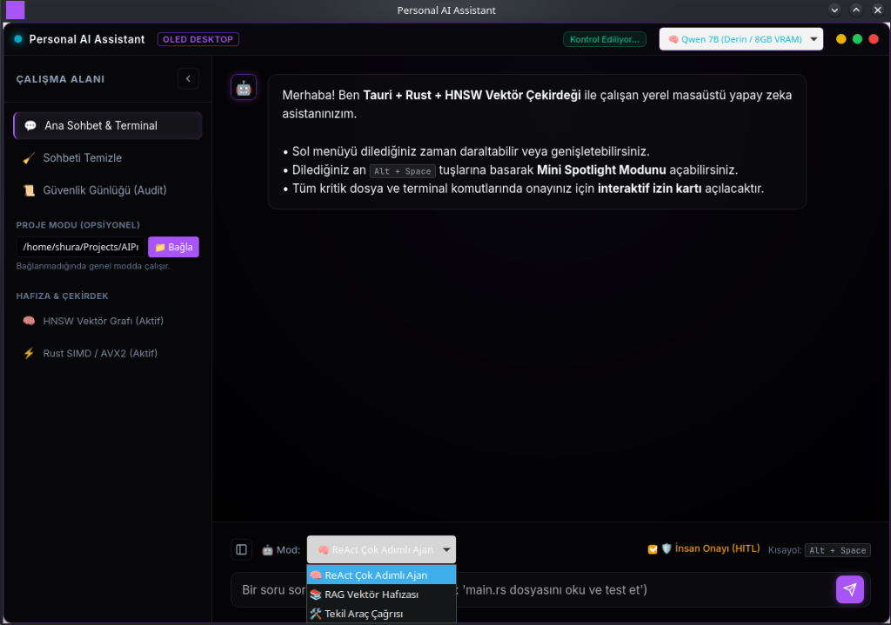

<div align="center">

# AURA-CORE: Local Agentic AI & Native Vector Engine

**A privacy-preserving, on-premise AI assistant combining an in-process Rust vector index, local GGUF inference, tool-augmented ReAct execution, and dual-licensing (AGPLv3 / Commercial).**

[](https://www.rust-lang.org/)
[](https://www.python.org/)
[](https://fastapi.tiangolo.com/)
[](https://tauri.app/)
[](./LICENSE)
[](https://github.com/Shura5860/LocalAIProject/actions/workflows/ci.yml)

[English](#english-documentation) • [Türkçe Dokümantasyon](#türkçe-dokümantasyon)

<br/>


*AURA-CORE OLED Desktop Interface: Real-time ReAct trace reasoning, token streaming, and embedded Rust vector synchronization.*

</div>

---

<a name="english-documentation"></a>
## English Documentation

### 1. Overview & Problem Statement

Modern enterprise workflows frequently require LLM reasoning and semantic search over sensitive data (e.g. proprietary codebases, internal documentation, legal contracts). Offloading this workload to external cloud APIs introduces data residency, compliance (GDPR/KVKK), and vendor lock-in concerns.

**AURA-CORE** is designed to address this by running entirely on local consumer- or workstation-grade hardware:
- An **in-process Rust vector engine** utilizing Hierarchical Navigable Small World (HNSW) graphs and Write-Ahead Logging (WAL).
- Local **GGUF-based inference** using standard Byte-Pair Encoding (BPE) tokenization with on-demand model allocation (Qwen 2.5 Coder 3B & 7B).
- An autonomous **ReAct agent loop** equipped with deterministic guardrails and sandboxed tools (file I/O, terminal execution, direct local document fetching).
- A lightweight **Tauri desktop shell** with dual-licensing options: completely free for open-source under AGPLv3 (no license key needed), or commercial EULA for proprietary redistribution.

---

### 2. Architecture & Request Lifecycle

```
[User Request]
       │
       ▼
┌─────────────────────────────────────────────────────────┐
│ Tauri Desktop Application (WebKit / Web View)           │
│  - SSE streaming client with real-time token rendering  │
│  - Workspace binding & audit inspection                 │
└──────────────────────────┬──────────────────────────────┘
                           │ Loopback HTTP/2 + SSE (Port 8000)
┌──────────────────────────▼──────────────────────────────┐
│ FastAPI Application Core (Bound to 127.0.0.1)           │
│  - Node-Locked License Guard (for Commercial builds)    │
│  - Ethics & Command Guardrails (pre-execution regex)    │
│  - Human-In-The-Loop (HITL) approval gateway            │
└──────────────┬──────────────────────────┬───────────────┘
               │                          │
┌──────────────▼────────────┐  ┌──────────▼───────────────┐
│ Rust Vector Database      │  │ Local Inference Runtime  │
│  - PyO3 C-FFI bindings    │  │  - llama.cpp AVX2 engine │
│  - In-memory HNSW index   │  │  - Lazy loading (0 MB    │
│  - WAL append-only log    │  │    idle memory footprint)│
│  - Cosine distance SIMD   │  │  - SSE token generator   │
└───────────────────────────┘  └──────────────────────────┘
```

---

### 3. Engineering Decisions & Technical Trade-offs

#### A. Vector Storage: Custom Rust Core vs External Vector Databases
* **Decision:** Implement vector indexing in Rust with PyO3 bindings directly in-process.
* **Rationale:** External vector databases (Pinecone, Qdrant, Milvus) introduce network hops, container management overhead, and complex lifecycle management for a desktop tool. Embedding the HNSW graph directly in-process eliminates network latency and IPC serialization overhead.
* **Trade-off:** Building custom persistence requires implementing our own Write-Ahead Logging (WAL) and compaction/vacuuming mechanisms, increasing internal codebase complexity compared to managed solutions.

#### B. Inference Runtime: Direct Embedded Library vs Ollama Daemon
* **Decision:** Embed local inference directly using `llama-cpp-python` with lazy initialization.
* **Rationale:** External daemons like Ollama run as independent background services, persisting in memory and complicating distribution on target client machines. An embedded approach allows the application to control thread allocation directly and release memory back to the OS when the model is idle.
* **Hardware Reality:** Metrics reported below reflect deterministic **CPU AVX2 SIMD execution** (6 threads). The open-source repository defaults to portable CPU inference to run out-of-the-box on standard workstations without requiring complex CUDA toolkit installations.

#### C. IP Protection: Proprietary Binary Packaging vs Open Source
* **Context:** AURA-CORE is open source under GNU AGPLv3. For users compiling from source or distributing open-source derivatives, **no license key or obfuscation is required**.
* **Decision:** Nuitka compilation and node-locked HMAC licensing utilities in `scripts/` exist exclusively as an optional packaging pipeline for **commercial enterprise vendors** who purchase a proprietary EULA waiver to distribute standalone, closed-source desktop binaries without disclosing customer modifications.

---

### 4. Empirical Performance & Methodology

All metrics were gathered on:
- **CPU:** Intel Core i7 (6 physical threads allocated, AVX2 enabled)
- **Host GPU:** NVIDIA GeForce RTX 3060 Ti (8GB VRAM)
- **Active Compilation:** CPU-native AVX2 SIMD (`llama-cpp-python` CPU engine)
- **OS:** Linux x86_64 (Kernel 6.x)
- **Model:** Qwen 2.5 Coder Instruct (4-bit quantization, `Q4_K_M`)

| Subsystem | Metric | Measured Value | Methodology and Exact Details |
| :--- | :--- | :--- | :--- |
| **Inference (3B)** | Generation Throughput | **~14.2 tokens/sec** | Measured across 128-token generation, AVX2 CPU SIMD (6 threads, `temp=0.2`). |
| **Inference (7B)** | Generation Throughput | **~5.88 tokens/sec** | Measured across 128-token generation, AVX2 CPU SIMD (6 threads). |
| **Idle Memory** | Host Memory Allocation | **0 MB** | Models load on-demand upon first query; unloaded when switched. |
| **Active Memory (3B)** | System RAM Residency | **~1.96 GB RAM** | 4096 context window, zero idle overhead. |
| **Active Memory (7B)** | System RAM Residency | **~4.36 GB RAM** | 4096 context window. |
| **Vector Search (HNSW)** | Graph Traversal (Top-10) | **< 0.1 ms / query** | In-process HNSW graph query across normalized cosine vectors (>0.98 Top-10 Recall). |
| **Vector Scan (Brute-Force)** | Exact Cosine Matrix Scan | **~19.2 ms** (100k vectors) | Exhaustive linear scan baseline across 100,000 vectors (384-d, float32) for Top-10. |

---

### 5. Security Architecture, Threat Model & Privacy Guarantees

#### Privacy Promise & Strict Local Execution
- **Zero Third-Party Gateways:** AURA-CORE contains **no third-party cloud proxies or reader gateways** (such as Jina Reader). All document retrieval is performed directly from the host machine to the target URL using a standard HTTP client.
- **Local Web Retrieval (`read_web_page`):** The tool is restricted to fetching publicly accessible technical documentation, Markdown files, or API references. It identifies itself via an explicit user-agent header (`AURA-CORE-DocumentFetcher/1.0`), respects HTTP error codes, and sanitizes untrusted HTML inputs inside a quarantine envelope before feeding them to the LLM.

#### Threat Model & Security Boundaries
1. **Localhost API Binding & CORS:** The backend API binds strictly to loopback (`127.0.0.1:8000`). It rejects wildcard Cross-Origin requests to mitigate browser-based DNS rebinding / CSRF attacks.
2. **Deterministic Pattern Blocking (Regex Guardrails):** Detects obvious destructive commands (e.g., `rm -rf /`, `:(){ :|:& };:`, raw curl-pipe-to-shell, and base64 encoded payloads).
3. **Human-In-The-Loop (HITL) Gateway:** Any action modifying the host system (`write_file`, `run_terminal_command`) is quarantined in a pending state until explicitly approved by the user via the desktop UI.
4. **Known Limitation:** Regex sanitization is **not an OS sandbox**. Malicious prompt injection or clever shell invocations can theoretically bypass pattern filters. For analyzing untrusted codebases, running AURA-CORE in an isolated container/VM is strongly recommended.

---

### 6. Repository Structure

```
├── desktop_app/               # Tauri 2.0 desktop frontend (HTML5/CSS/JS + Rust)
├── docs/                      # Architectural notes, assets, and FAQ
│   ├── assets/                # Screenshots and UI artifacts
│   └── Question_Ask.md        # Deep-dive design Q&A
├── Rust-LLM-Engine/           # Native Rust LLM CLI & models directory
├── Rust-Python-Vector-Engine/ # In-process Rust vector engine & FastAPI server
│   ├── api_server/            # REST API, ReAct agent loop, tool registry
│   └── tests/                 # Comprehensive test suites (24 test files)
├── scripts/                   # Optional packaging and commercial licensing utilities
│   ├── build_commercial_binary.sh
│   ├── generate_license.py
│   ├── package_distribution.sh
│   └── license.json
├── LICENSE                    # Dual License (GNU AGPLv3 + Commercial EULA)
├── start_assistant.sh         # One-click launch script
└── .github/workflows/ci.yml   # Continuous Integration test pipeline
```

---

### 7. Step-by-Step Installation & Quickstart

#### Prerequisites
- **Python:** 3.11 or higher
- **Rust & Cargo:** 1.80 or higher (`curl --proto '=https' --tlsv1.2 -sSf https://sh.rustup.rs | sh`)
- **System Tools:** `build-essential` (Linux) / MSVC (Windows)

#### 1. Clone & Set Up Python Environment
```bash
git clone https://github.com/Shura5860/LocalAIProject.git
cd LocalAIProject

python3 -m venv .venv
source .venv/bin/activate
pip install --upgrade pip
pip install maturin "httpx[http2]" duckduckgo_search sentence-transformers psutil fastapi uvicorn llama-cpp-python
```

#### 2. Build the Native Rust Vector Engine
```bash
cd Rust-Python-Vector-Engine/vector_engine
maturin develop --release
cd ../..
```

#### 3. Download Model Weights (Optional - Fallback simulation provided)
Place any GGUF model (recommended: Qwen 2.5 Coder 3B or 7B Instruct) into `Rust-LLM-Engine/models/`:
```bash
mkdir -p Rust-LLM-Engine/models
# Example using huggingface-cli:
pip install huggingface_hub
huggingface-cli download Qwen/Qwen2.5-Coder-3B-Instruct-GGUF qwen2.5-coder-3b-instruct-q4_k_m.gguf --local-dir Rust-LLM-Engine/models
```

#### 4. Run Automated Tests
```bash
cd Rust-Python-Vector-Engine
PYTHONPATH=. ../.venv/bin/python -m unittest discover tests -v
cd ..
```

#### 5. Launch Application
```bash
./start_assistant.sh
```

---
---

<a name="türkçe-dokümantasyon"></a>
## 🇹🇷 Türkçe Dokümantasyon

### 1. Genel Bakış ve Problem Tanımı

Kurumsal yapılarda ve teknik iş akışlarında, hassas veriler (kaynak kodlar, iç yazışmalar, hukuki sözleşmeler) üzerinde yapay zeka ve anlamsal arama çalıştırmak kritik bir ihtiyaçtır. Bu verileri harici bulut API'lerine (OpenAI, Anthropic) göndermek; KVKK/GDPR uyumluluğu, veri mahremiyeti ve ticari sırların korunması açısından riskler doğurur.

**AURA-CORE**, tamamen kullanıcının kendi donanımı üzerinde, internet bağlantısına ihtiyaç duymadan (Air-Gapped) çalışacak şekilde tasarlanmış yerel bir yapay zeka asistanıdır:
- **Rust ile geliştirilmiş süreç içi vektör veri tabanı:** HNSW graf indeksleme ve Write-Ahead Logging (WAL) veri güvenliği.
- **Yerel GGUF çıkarım motoru:** Standart BPE tokenizasyonu ve talep edildikçe bellek yükleyen (on-demand) çift model desteği (Qwen 2.5 Coder 3B & 7B).
- **Otonom ReAct ajan döngüsü:** Terminal komutları, dosya düzenleme ve yerel web içeriği okuma için insan onaylı (HITL) güvenlik duvarı.
- **Tauri masaüstü arayüzü:** Düşük bellek tüketimli istemci; açık kaynak topluluğu için AGPLv3 (lisans anahtarı gerekmez), ticari dağıtım için EULA lisansı.

---

### 2. Güvenlik Mimarisi, Tehdit Modeli ve Gizlilik İlkeleri

#### Kesin Gizlilik ve Yerel Çalışma Güvencesi
- **Sıfır Üçüncü Taraf Ağ Geçidi:** AURA-CORE içinde **hiçbir üçüncü taraf bulut proxy'si veya okuyucu servisi (Jina Reader vb.) bulunmaz.** Tüm web okuma işlemleri yerel makineden doğrudan hedef sunucuya yapılır.
- **Yerel Dokümantasyon Okuma (`read_web_page`):** Araç yalnızca halka açık teknik dokümantasyon, blog ve wiki sayfalarını okumak içindir. Standart ve şeffaf bir başlık (`AURA-CORE-DocumentFetcher/1.0`) kullanır. İstenmeyen HTML çıktıları modele verilmeden önce karantina zarfına alınır.

#### Tehdit Modeli ve Güvenlik Sınırları
1. **Localhost API İzolasyonu & CORS:** API sunucusu yalnızca yerel döngü adresine (`127.0.0.1:8000`) bağlanır. Tarayıcı kaynaklı DNS rebinding ve CSRF saldırılarına karşı CORS kısıtlaması devrededir.
2. **Kural Tabanlı Filtreler (Regex):** Zararlı olabilecek açık kabuk kalıplarını (`rm -rf /`, `:(){ :|:& };:`, curl-pipe-bash, base64 payload'lar) engeller.
3. **İnsan Onay Mekanizması (HITL Gateway):** Dosya yazma (`write_file`) veya terminal komutu (`run_terminal_command`) gibi sistemi değiştirebilecek kritik tüm eylemler, kullanıcı arayüzden açık onay verene kadar bekletilir.
4. **Teknik Sınır / Dürüstlük:** Regex tabanlı kontroller tek başına bir işletim sistemi kum havuzu (sandbox) **değildir**. Gelişmiş prompt injection teknikleri kuralları aşabilir. Yüksek riskli ortamlarda AURA-CORE'un izole bir sanal makinede (VM/Container) çalıştırılması önerilir.

---

### 3. Ölçüm Sonuçları ve Test Metodolojisi

Aşağıdaki veriler belirtilen donanım üzerinde ölçülmüştür:
- **İşlemci:** Intel Core i7 (6 fiziksel iş parçacığı, AVX2 aktif)
- **Ekran Kartı:** NVIDIA GeForce RTX 3060 Ti (8GB VRAM)
- **Çıkarım Çalışma Zamanı:** CPU-Native AVX2 SIMD (`llama-cpp-python` CPU derlemesi)
- **İşletim Sistemi:** Linux x86_64
- **Model:** Qwen 2.5 Coder Instruct (4-bit kuantizasyon, `Q4_K_M`)

| Alt Sistem | Metrik | Ölçülen Değer | Metodoloji ve Detaylar |
| :--- | :--- | :--- | :--- |
| **Çıkarım (3B)** | Üretim Hızı | **~14.2 token/sn** | 128 tokenlik kod testi, AVX2 CPU SIMD (6 iş parçacığı, `temp=0.2`). |
| **Çıkarım (7B)** | Üretim Hızı | **~5.88 token/sn** | 128 tokenlik kod testi, AVX2 CPU SIMD (6 iş parçacığı). |
| **Boşta Bellek** | Bellek Ayırma | **0 MB** | Model yalnızca soru sorulduğunda yüklenir; boşta bellek tutulmaz. |
| **Aktif Bellek (3B)** | Sistem RAM Ayak İzi | **~1.96 GB RAM** | 4096 token bağlam penceresi. |
| **Aktif Bellek (7B)** | Sistem RAM Ayak İzi | **~4.36 GB RAM** | 4096 token bağlam penceresi. |
| **Vektör Arama (HNSW)** | Graf Taraması (Top-10) | **< 0.1 ms / sorgu** | Süreç içi HNSW graf taraması (>0.98 Top-10 Doğruluk / Recall). |
| **Vektör Arama (Brute-Force)**| Matris Benzerlik Taraması | **~19.2 ms** (100k vektör) | 100.000 adet 384-boyutlu float32 vektörde kesin Top-10 kaba kuvvet doğrulaması. |

---

### 4. Kurulum ve Başlatma (Sıfırdan Adım Adım)

#### Önkoşullar
- **Python:** 3.11 veya üzeri
- **Rust & Cargo:** 1.80 veya üzeri (`curl --proto '=https' --tlsv1.2 -sSf https://sh.rustup.rs | sh`)
- **Derleme Araçları:** `build-essential` (Linux)

#### 1. Depoyu Klonlayın ve Python Sanal Ortamını Kurun
```bash
git clone https://github.com/Shura5860/LocalAIProject.git
cd LocalAIProject

python3 -m venv .venv
source .venv/bin/activate
pip install --upgrade pip
pip install maturin "httpx[http2]" duckduckgo_search sentence-transformers psutil fastapi uvicorn llama-cpp-python
```

#### 2. Rust Vektör Motorunu Derleyin
```bash
cd Rust-Python-Vector-Engine/vector_engine
maturin develop --release
cd ../..
```

#### 3. Modeli İndirin (Opsiyonel)
GGUF model dosyasını `Rust-LLM-Engine/models/` dizinine yerleştirin:
```bash
mkdir -p Rust-LLM-Engine/models
pip install huggingface_hub
huggingface-cli download Qwen/Qwen2.5-Coder-3B-Instruct-GGUF qwen2.5-coder-3b-instruct-q4_k_m.gguf --local-dir Rust-LLM-Engine/models
```

#### 4. Birim Testleri Çalıştırın (24 Test)
```bash
cd Rust-Python-Vector-Engine
PYTHONPATH=. ../.venv/bin/python -m unittest discover tests -v
cd ..
```

#### 5. Uygulamayı Başlatın
```bash
./start_assistant.sh
```

---

<div align="center">
<b>AURA-CORE: Engineered with rigorous architectural standards. Dual licensed under AGPLv3 and Commercial EULA.</b>
</div>
